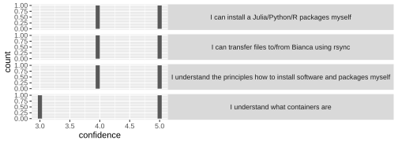
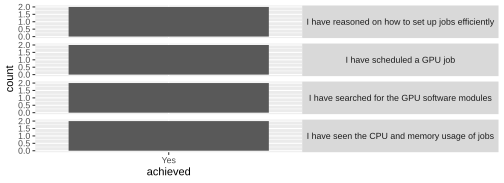

# Evaluation Bianca Intermediate 2026-11-23

- Course: Bianca Intermediate
- Date: 2026-11-23
- [Lesson plan](../../lesson_plans/20261123/20261123_richel.md)
- [Evaluation](../../evaluations/20261123/README.md)
- [Reflection](../../reflections/20261123/20261123_richel.md)

## Data

- [Evaluation results](evaluation_results.csv)
- [Analysis script](analysis.R)

## Results

### [Any feedback](any_feedback.txt)

- Good material!
- The course was at a good pace, I had time to solve all the exercise
  without stress. All the teachers are very helpful and knowledgeable.
  Thank you for organizing it!

