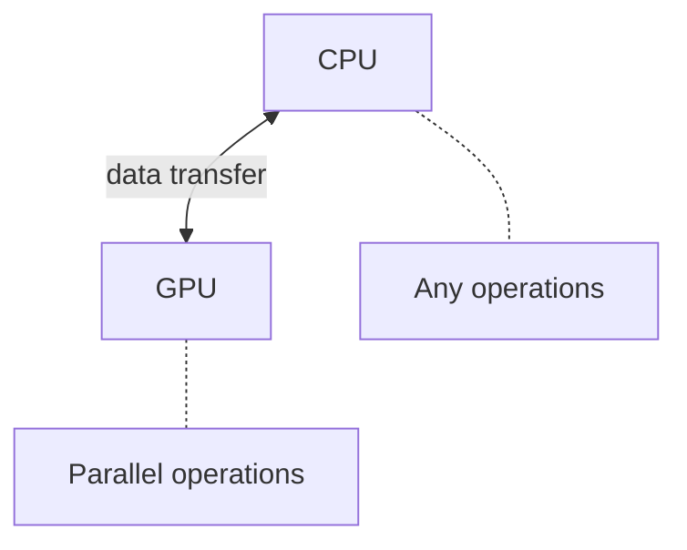
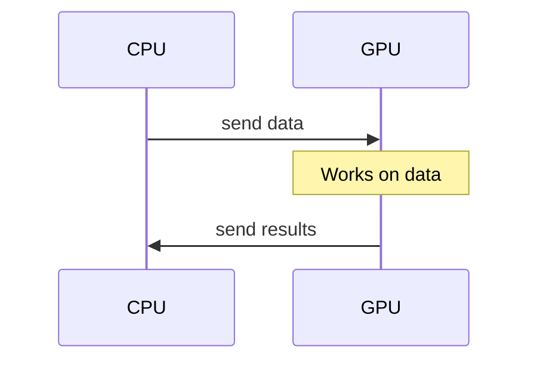
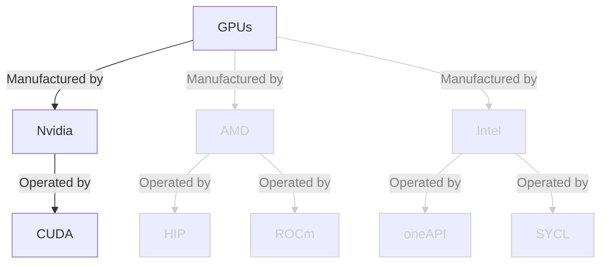

---
tags:
  - lesson
  - session
  - GPU
  - graphical processing unit
---


# GPUs


!!! quote

    Not our universe, not our ship. Something... parallel.

    James T. Kirk, a fictional Star Trek character, episode 'Mirror, Mirror'

## Goal

- Book a GPU on Bianca
- Have an idea when to do so

## What are GPUs?

A GPU, short for 'graphical processing unit', can do calculations.
GPUs do not need to be used for graphics, however.
Instead, they are specialized in doing any type of parallel computation,
such as, for example, matrix multiplications.

## Why use GPUs?

- Your calculation *may* go faster
- You have access to more GPUs than CPUs <!-- gpuavail -->

## How to schedule GPUs on Bianca

To start a 10-minute interactive session on 1 GPU:

```bash
interactive -A sens2025560 -C gpu
```

???- question "What does that look like?"

    The output will look similar to:

    ```
    [maja@sens2025560-bianca maja]$ interactive -A sens2025560 -C gpu
    You receive the high interactive priority.
    You may run for at most 12 hours.
    Please note that in 12 wallclock hours this interactive job will use 192 core hours.

    Please, use no more than 14 GB of RAM.

    Waiting for job 679 to start...
    ```

    After a while (I expect this to take 20 minutes) you will see:

    ```bash
     _   _ ____  ____  __  __    _    __  __
    | | | |  _ \|  _ \|  \/  |  / \   \ \/ /   | System:    sens2025560-b201
    | | | | |_) | |_) | |\/| | / _ \   \  /    | User:      maja
    | |_| |  __/|  __/| |  | |/ ___ \  /  \    | 
     \___/|_|   |_|   |_|  |_/_/   \_\/_/\_\   | 

    ###############################################################################

            User Guides: http://www.uppmax.uu.se/support/user-guides
            FAQ: http://www.uppmax.uu.se/support/faq

            Write to support@uppmax.uu.se, if you have questions or comments.


    [maja@sens2025560-b201 maja]$ 
    ```

???- question "What about other command line parameters?"

    This command:

    ```bash
    interactive -A sens2025560 -C gpu
    ```

    is identical to:

    ```bash
    interactive -A sens2025560 -C gpu --gpus=1 --gpus-per-node=1 --t=10:00:00
    ```

## How to search modules that use GPUs on Bianca

module spider gpu
module spider cuda

```
[richel@sens2025560-b201 richel]$ module --redirect -r spider '.*cuda.*' > cuda_modules_from_gpu.txt
[richel@sens2025560-b201 richel]$ module --redirect -r spider '.*gpu.*' > gpu_modules_from_gpu.txt
```


One uses GPUs when this is faster.
GPUs are **not** always faster.

For smaller data, CPU is faster `[Barker et al., 2026][Haryanto et al., 2026]`.


https://doi.org/10.33650/coreai.v7i1.15758


GPUs are likelier to be faster, when

- the data you work on is big
- the calculations you do are 

They have hard-wired operations





- [Nvidia applications](https://marketplace.nvidia.com/en-us/enterprise/applications/)


When working with GPUs, the computer's CPU is called the 'host CPU'.


## Differences

- GPU is specialized on floating point and array operations
- Values must be copied to it
- Results must be copied back

- [Programming for GPU](https://docs.nvidia.com/cuda/cuda-programming-guide/part2.html)




!!! warning "Benchmarks may be misleading"

    Benchmarks you find online may focus on code readability,
    but these may be unfair due to this.

    - There is an **optimization bias**, where CPU code
      uses slow constructs (e.g. a raw `for` loop, instead of using a
      vectorized version) where the GPU is optimized. Optimizing the CPU
      code can flip the conclusion from the GPU being 5x faster to the
      CPU being 41% faster `[Shanbhag et al., 2020]`
    - Ignore **memory transfer overhead**:
      when you load a variable in Python, it is in CPU.
      To make a GPU do something, these values must be copied to it,
      and the results must be copied back. In naive benchmarks, this transfer
      of the data is part of the timed GPU part.
      This overhead may be 50-98% of the whole calculation if it is included
      `[Gregg and Hazelwood, 2011]`
    - Ignore warm-ups: both CPU and GPU need to allocate memory. A memory
      allocation takes an indeterminate amount of time, hence this will be
      a source of noise for both CPU and GPU


## GPU software modules on Bianca





When on CPU and doing `module spider gpu`, these are all the hits:

Module                         |Description
-------------------------------|--------------------------------------------------------
Guppy                          |Oxford Nanopore neural-net basecaller, GPU enabled
Megalodon                      |Base and sequence variant caller from raw nanopore reads
`python_ML_packages/3.9.5-gpu` |Python GPU packages

The two `python_ML_packages` differ between CPU and GPU:

=== `python_ML_packages/3.9.5-gpu`

    ```text
    Package                      Version
    ---------------------------- -------------------
    absl-py                      1.0.0
    astunparse                   1.6.3
    Babel                        2.14.0
    cachetools                   5.0.0
    certifi                      2024.8.30
    charset-normalizer           3.4.0
    click                        8.1.7
    cloudpickle                  2.2.1
    colorama                     0.4.6
    cycler                       0.11.0
    dill                         0.3.6
    dm-tree                      0.1.8
    filelock                     3.16.1
    flatbuffers                  2.0
    fonttools                    4.31.2
    fsspec                       2024.10.0
    gast                         0.5.3
    ghp-import                   2.1.0
    google-auth                  2.6.0
    google-auth-oauthlib         0.4.6
    google-pasta                 0.2.0
    googleapis-common-protos     1.56.4
    grpcio                       1.44.0
    htmlmin                      0.1.12
    huggingface-hub              0.26.2
    idna                         3.10
    importlib-metadata           4.11.3
    Jinja2                       3.1.3
    keras                        2.8.0
    Keras-Preprocessing          1.1.2
    kiwisolver                   1.4.0
    libclang                     13.0.0
    Markdown                     3.5.2
    markdown-fenced-code-tabs    1.0.5
    MarkupSafe                   2.1.5
    matplotlib                   3.5.1
    mergedeep                    1.3.4
    mkdocs                       1.5.3
    mkdocs-material              9.5.12
    mkdocs-material-extensions   1.3.1
    munkres                      1.1.4
    numpy                        1.22.3
    oauthlib                     3.2.0
    opt-einsum                   3.3.0
    packaging                    24.1
    paginate                     0.5.6
    pathspec                     0.12.1
    Pillow                       9.0.1
    pip                          22.0.4
    platformdirs                 4.2.0
    promise                      2.3
    protobuf                     3.19.4
    pyasn1                       0.4.8
    pyasn1-modules               0.2.8
    Pygments                     2.17.2
    pymdown-extensions           10.7.1
    pyparsing                    3.0.7
    PyQt5                        5.12.3
    PyQt5_sip                    4.19.18
    PyQtChart                    5.12
    PyQtWebEngine                5.12.1
    python-dateutil              2.8.2
    PyYAML                       6.0.2
    pyyaml_env_tag               0.1
    regex                        2023.12.25
    requests                     2.32.3
    requests-oauthlib            1.3.1
    rsa                          4.8
    scikit-learn                 1.0.2
    scipy                        1.12.0
    seaborn                      0.11.2
    setuptools                   61.1.1
    six                          1.16.0
    tensorboard                  2.8.0
    tensorboard-data-server      0.6.1
    tensorboard-plugin-wit       1.8.1
    tensorflow-datasets          3.2.1
    tensorflow-gpu               2.8.0
    tensorflow-io-gcs-filesystem 0.24.0
    tensorflow-metadata          1.12.0
    tensorflow-probability       0.13.0
    termcolor                    1.1.0
    tf-estimator-nightly         2.8.0.dev2021122109
    Theano                       1.0.5
    threadpoolctl                3.1.0
    torch                        1.9.0+cu111
    torchaudio                   0.9.0
    torchvision                  0.10.0+cu111
    tornado                      6.1
    tqdm                         4.67.0
    typing_extensions            4.12.2
    unicodedata2                 14.0.0
    urllib3                      2.2.3
    watchdog                     4.0.0
    Werkzeug                     2.0.3
    wheel                        0.37.1
    wrapt                        1.14.0
    zipp                         3.7.0
    ```

=== `python_ML_packages/3.9.5-cpu` 

    ```text
    Package                      Version
    ---------------------------- -------------------
    absl-py                      1.0.0
    anndata                      0.8.0
    appdirs                      1.4.4
    argon2-cffi                  20.1.0
    asteval                      0.9.25
    astunparse                   1.6.3
    async-generator              1.10
    attrs                        21.2.0
    Automat                      20.2.0
    backcall                     0.2.0
    bleach                       3.3.0
    cachetools                   5.0.0
    certifi                      2021.5.30
    cffi                         1.14.5
    cget                         0.1.9
    chardet                      4.0.0
    click                        8.0.1
    cloudpickle                  2.2.1
    constantly                   15.1.0
    cramjam                      2.6.2
    cycler                       0.10.0
    Cython                       0.29.23
    decorator                    4.4.2
    defusedxml                   0.7.1
    dill                         0.3.4
    distlib                      0.3.2
    dm-tree                      0.1.8
    ducc0                        0.29.0
    entrypoints                  0.3
    et-xmlfile                   1.1.0
    fastparquet                  0.8.3
    filelock                     3.0.12
    flatbuffers                  2.0
    fsspec                       2022.11.0
    future                       0.18.2
    gast                         0.5.3
    gitdb                        4.0.7
    GitPython                    3.1.17
    google-auth                  2.6.0
    google-auth-oauthlib         0.4.6
    google-pasta                 0.2.0
    googleapis-common-protos     1.56.4
    graphviz                     0.16
    grpcio                       1.44.0
    h5py                         3.2.1
    hyperlink                    21.0.0
    idna                         2.10
    imbalanced-learn             0.10.1
    importlib-metadata           4.11.2
    incremental                  21.3.0
    iniconfig                    1.1.1
    ipykernel                    5.5.5
    ipython                      7.24.1
    ipython-genutils             0.2.0
    ipywidgets                   7.6.3
    jedi                         0.18.0
    Jinja2                       3.0.1
    joblib                       1.2.0
    jsonschema                   3.2.0
    jupyter                      1.0.0
    jupyter-client               6.1.12
    jupyter-console              6.4.0
    jupyter-core                 4.7.1
    jupyterlab-pygments          0.1.2
    jupyterlab-widgets           1.0.0
    keras                        2.8.0
    Keras-Preprocessing          1.1.2
    kiwisolver                   1.3.1
    libclang                     13.0.0
    lmfit                        1.0.3
    Markdown                     3.3.6
    MarkupSafe                   2.0.1
    matplotlib                   3.4.2
    matplotlib-inline            0.1.2
    mistune                      0.8.4
    mock                         4.0.3
    natsort                      7.1.1
    nbclient                     0.5.3
    nbconvert                    6.0.7
    nbformat                     5.1.3
    nest-asyncio                 1.5.1
    networkx                     2.5.1
    nlp                          0.4.0
    nltk                         3.6.2
    nose                         1.3.7
    notebook                     6.4.0
    numpy                        1.20.3
    oauthlib                     3.2.0
    openpyxl                     3.0.10
    opt-einsum                   3.3.0
    packaging                    20.9
    pandas                       1.2.4
    pandocfilters                1.4.3
    parso                        0.8.2
    patsy                        0.5.2
    pexpect                      4.8.0
    pickleshare                  0.7.5
    Pillow                       8.2.0
    pip                          21.1.2
    pluggy                       0.13.1
    prometheus-client            0.11.0
    promise                      2.3
    prompt-toolkit               3.0.18
    protobuf                     3.19.4
    ptyprocess                   0.7.0
    py                           1.10.0
    pyarrow                      7.0.0
    pyasn1                       0.4.8
    pyasn1-modules               0.2.8
    pycparser                    2.20
    pydot                        1.4.2
    Pygments                     2.9.0
    pyparsing                    2.4.7
    PyQt5                        5.15.4
    PyQt5-Qt5                    5.15.2
    PyQt5-sip                    12.9.0
    pyrsistent                   0.17.3
    pysqlite3                    0.4.6
    pytest                       6.2.4
    python-dateutil              2.8.1
    python-graph-core            1.8.2
    python-graph-dot             1.8.2
    python-qt-binding            0.3.4
    pytz                         2021.1
    PyYAML                       5.4.1
    pyzmq                        22.1.0
    qtconsole                    5.1.0
    qtgui                        0.0.1
    QtPy                         1.9.0
    regex                        2021.4.4
    reportlab                    3.5.67
    requests                     2.25.1
    requests-oauthlib            1.3.1
    rsa                          4.8
    scikit-learn                 1.0.2
    scipy                        1.6.3
    seaborn                      0.11.2
    Send2Trash                   1.5.0
    setuptools                   57.0.0
    singledispatch               3.6.2
    six                          1.16.0
    smmap                        4.0.0
    statsmodels                  0.13.1
    tensorboard                  2.8.0
    tensorboard-data-server      0.6.1
    tensorboard-plugin-wit       1.8.1
    tensorflow                   2.8.0
    tensorflow-datasets          3.2.1
    tensorflow-io-gcs-filesystem 0.24.0
    tensorflow-metadata          1.12.0
    tensorflow-probability       0.13.0
    termcolor                    1.1.0
    terminado                    0.10.0
    testpath                     0.5.0
    tf-estimator-nightly         2.8.0.dev2021122109
    tflite-runtime               2.10.0
    Theano                       1.0.5
    threadpoolctl                3.1.0
    toml                         0.10.2
    torch                        1.11.0
    tornado                      6.1
    tqdm                         4.61.0
    traitlets                    5.0.5
    Twisted                      21.2.0
    typing-extensions            4.1.1
    uncertainties                3.1.6
    urllib3                      1.26.5
    virtualenv                   20.4.7
    wcwidth                      0.2.5
    webencodings                 0.5.1
    Werkzeug                     2.0.3
    wheel                        0.36.2
    widgetsnbextension           3.5.1
    wrapt                        1.14.0
    xxhash                       3.0.0
    zipp                         3.7.0
    zope.interface               5.4.0
    ```


In the docu

On CPU:

```bash
[richel@sens2025560-bianca richel]$ module spider numba
Lmod has detected the following error:  Unable to find: "numba".


[richel@sens2025560-bianca richel]$ module spider llvmlite
Lmod has detected the following error:  Unable to find: "llvmlite".
```

On GPU:

```bash
[richel@sens2025560-b201 richel]$ module spider numba
Lmod has detected the following error:  Unable to find: "numba".

[richel@sens2025560-b201 richel]$ module spider llvmlite
Lmod has detected the following error:  Unable to find: "llvmlite".
```

Alternatively, `module spider cuda`, gives you this:

TODO


## Scheduling GPUs

These are all identical:

- `-C gpu`
- `-C gpu --gpus=1` <!-- untested, but I am condident -->
- `-C gpu --gpus-per-node=1`
- `-C gpu --gpus=1 --gpus-per-node=1`

GPUs are expensive: 1 GPU hour is 16 CPU hours


## Check

Run the following script:

```python
import torch
assert torch.cuda.is_available(), "CUDA not available"
# print(torch.cuda.get_device_properties(0))
```


If there is a GPU:

```bash
# No output, but check

# _CudaDeviceProperties(name='NVIDIA A100-PCIE-40GB', major=8, minor=0, total_memory=40326MB, multi_processor_count=108)
```

If there is no GPU:

```bash
# The assert message here

#Traceback (most recent call last):
#  File "<string>", line 1, in <module>
#  File "/sw/apps/python_ML_packages/3.9.5-gpu/bianca/lib/python3.9/site-packages/torch/cuda/__init__.py", line 309, in get_device_properties
#    _lazy_init()  # will define _get_device_properties
#  File "/sw/apps/python_ML_packages/3.9.5-gpu/bianca/lib/python3.9/site-packages/torch/cuda/__init__.py", line 172, in _lazy_init
#    torch._C._cuda_init()
#RuntimeError: Found no NVIDIA driver on your system. Please check that you have an NVIDIA GPU and installed a driver from http://www.nvidia.com/Download/index.aspx
```


## Exercises

## Exercise 1: run a GPU job

Copy-paste the following two scripts to Bianca:

Create this file, call it `gpus_1.sh`:

```bash
#!/bin/bash
#SBATCH -A sens2025560
#SBATCH -C gpu
#SBATCH --gpus=1
#SBATCH --gpus-per-node=1
module load python_ML_packages/3.9.5-gpu
python gpus_1.py
```

Create this file, call it `gpus_1.py`:

```bash
import torch
assert torch.cuda.is_available(), "CUDA not available"
```

Then schedule it:

```bash
sbatch gpus_1.sh
```


## References

- `[Barker et al., 2026]`
  Barker, R., Boone, J., Seyfi, T., Dorcheh, A. E., Afghah, F., & Boccuzzi, J.
  (2026). Six Times to Spare: Characterizing GPU-Accelerated 5G LDPC Decoding
  for Edge-RSU Communications. IEEE Vehicular Technology Conference,
  `abs/2602.04652`, 1-7.
  [DOI](https://doi.org/10.1109/vtc2026-fall68024.2026.11758285)

???- question "Summary of `[Barker et al., 2026]`"

    The paper benchmarks 2 CPUs and 2 GPUs.
    
    In figure 2a, shown below, it shows that bigger data (in this case,
    the number of codewords) gives highest throughput with a GPU
    (the red line). At the left side, however, for smaller data, the
    CPUs and GPUs have a similar throughput. Even though this is not visible,
    the authors state that the CPU throughput is higher.

    ![Adapted from `[Barker et al., 2026]` figure 2a](barker_et_al_2026_fig_2a.svg)

- `[Fridman et al, 2025]`
  Fridman, Yehonatan, Yosef Goren, and Gal Oren.
  "From OpenACC to OpenMP5 GPU offloading: Performance evaluation on NAS
  parallel benchmarks." Proceedings of the 2025 4th International Workshop
  on Extreme Heterogeneity Solutions. 2025.

???- question "Summary of `[Fridman et al, 2025]`"

    The paper benchmarks 1 CPU and 2 GPUs.

    On the horizontal axis, these are different benchmarks.
    Classes are from simple (class A) to most complex (class D).
    `OpenACC-A100-80G` (blue) and `OpenMP-S2S-A100-80G` (red) are GPU,
    `OpenMP-Orig-SPR-192cores` (brown) is CPU.
    We see that for the simpler problems (class A) that CPU is likelier
    to have a shorter execution time.
    We see that for the more complex problems (class D) that GPU is likelier
    to have a shorter execution time.

    ![Adapted from `[Fridman et al, 2025]` figure 1](fridman_et_al_2025_fig_1.svg)


- `[Gregg and Hazelwood, 2011]`
  Gregg, C., & Hazelwood, K. (2011). Where is the data? Why you cannot debate
  CPU vs. GPU performance without the answer. IEEE International Symposium on
  Performance Analysis of Systems and Software (ISPASS), 134-144.
  [DOI](https://doi.org/10.1109/ispass.2011.5762730)


- `[Haryanto et al., 2026]`
  D. Haryanto, M. N. Hoiri, A. Sidiq, A. Azzahrah, and Amarudin,
  "Performance evaluation of CPU and GPU architectures in Google Colab-based
  parallel computing using execution time and speedup,"
  COREAI: Jurnal Kecerdasan Buatan, Komputasi dan Teknologi Informasi,
  vol. 7, no. 1, 2026.
  [doi: 10.33650/coreai.v7i1.15758](https://doi.org/10.33650/coreai.v7i1.15758).

???- question "Summary of `[Haryanto et al., 2026]`"

    The paper benchmarks CPU and GPU for doing matrix multiplications.

    We see for a matrix size of 500x500, the CPU is faster:

    ![Adapted from `[Haryanto et al., 2026]` figure 1](haryanto_et_al_2026_fig_1.svg)


- `[Shanbhag et al., 2020]` Shanbhag, A., Madden, S., & Yu, X. (2020).
  A Study of the Fundamental Performance Characteristics of GPUs and CPUs
  for Database Analytics. ACM SIGMOD International Conference on Management
  of Data (SIGMOD), 1617-1632.
  [DOI](https://doi.org/10.1145/3318464.3380595)


<!----------------- OLD STUFF ---------------------------------------------->
<!----------------- OLD STUFF ---------------------------------------------->
<!----------------- OLD STUFF ---------------------------------------------->

!!!- info "Learning outcomes"

    - Practice using the UPPMAX documentation
    - I can see the GPU and memory usage of jobs
    - I know the correct flags to utilize GPUs.
    - I understand the GPU configuration on Bianca.


## Hardware and flags

- 10 Nodes with 2 Nvidia A100 40 GB each.
- Nodelist : ``sens2025xxx-b[201-210]``
- All GPU nodes have at least 256 GB RAM (fat nodes) with 16 CPU cores and 2 GPUs per node.
- In order to avoid GPU misuse, a project cannot request more than 7 GPU nodes, in total.
- SBATCH flags:

```bash
#SBATCH -A sens2025xxx
#SBATCH -p node
#SBATCH -N 1
#SBATCH -C gpu
#SBATCH --gpus-per-node=2   #number of GPUs per node
#SBATCH -t 1:00:00

nvidia-smi
```

You can also ask for 1 gpu per node and few cores in order to use 2 gpus for different jobs:

```bash
#SBATCH -A sens2025xxx
#SBATCH -p core
#SBATCH -n 8
#SBATCH -C gpu
#SBATCH --gpus-per-node=1
#SBATCH -t 1:00:00
```

- Similarly for interactive session on GPU node, use the same `-C gpu --gpus-per-node=` flag.

## News

- Bianca will have 17 T4 GPU nodes with one GPU each. Those will be on old Haswell nodes.

## GPU accessibility check

- Sanity check if CUDA is loaded properly by checking CUDA environment variable:

```bash
env | grep CUDA
CUDA_VISIBLE_DEVICES=0
```

OR

```bash
echo $CUDA_VISIBLE_DEVICES
0
```

OR check by loading torch:

```bash
module load python_ML_packages/3.9.5-gpu
python -c "import torch; print(torch.__version__); print(torch.version.cuda); print(torch.cuda.get_device_properties(0)); print(torch.randn(1).cuda())"
```

output:

```bash
1.9.0+cu111
11.1
_CudaDeviceProperties(name='NVIDIA A100-PCIE-40GB', major=8, minor=0, total_memory=40326MB, multi_processor_count=108)
tensor([0.1014], device='cuda:0')
```

!!! tip "Get a view of the whole queue, including all projects"

    - Use the command `bianca_combined_jobinfo` (queued jobs of all projects)
        - That makes it easier to see how the resources are used and what the odds are that you can start your job soon!
        - Slurm showing state as 'unkown' might mean that a VM has been booked on that node but no job is running.

## Profiling

- Monitor GPU utilization with nvidia-smi:

    ```bash
    nvidia-smi dmon -o DT
    nvidia-smi --format=noheader,csv --query-compute-apps=timestamp,gpu_name,pid,name,used_memory --loop=1 -f sample_run.log
    ```

## Tips

- If you book 1 GPU with `--gpus-per-node=1` flag, you block 1 full GPU node.
    - You can get another GPU on the same node faster.
- Use `--nv` flag while running your apptainer containers to use GPU on a GPU node
- Correct CUDA modules gets automatically loaded if you use `python_ML_packages/3.9.5-gpu`
- Various CUDA libraries are available in `module spider cuda`
