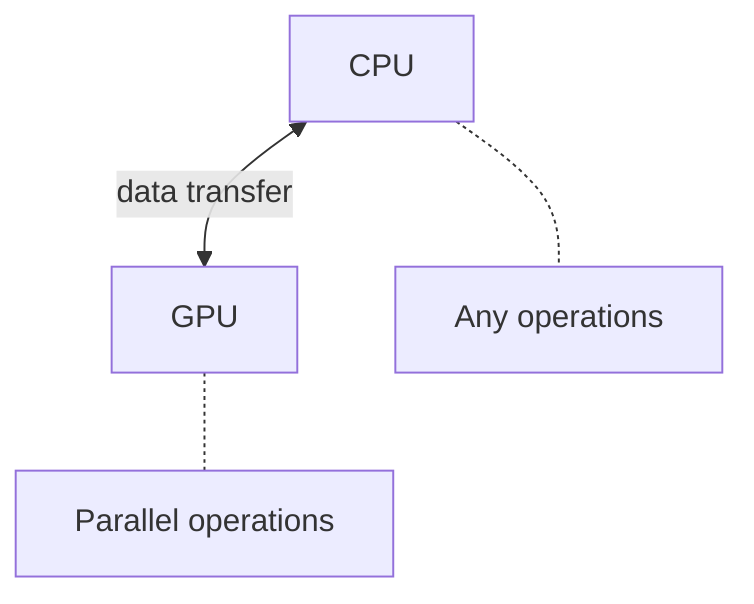

---
tags:
  - lesson
  - session
  - GPU
  - graphical processing unit
---

# GPUs

{width="200"}

!!! quote

    Not our universe, not our ship. Something... parallel.

    James T. Kirk, a fictional Star Trek character, episode 'Mirror, Mirror'

## Goal

- Book a GPU on Bianca <!-- Exercise 1 -->
- Search for GPU modules on Bianca <!-- Exercise 2 -->
- (optional) Have an idea when to use GPUs <!-- Exercise 3 -->
- (optional) To be fooled less likely by CPU versus GPU
  benchmarks <!-- Exercise 4 -->

## What are GPUs?

A GPU, short for 'graphical processing unit', can do calculations.
GPUs do not need to be used for graphics, however.
Instead, they are specialized in doing any type of parallel computation,
such as, for example, matrix multiplications.



## Why use GPUs?

- Your calculation *may* go faster
- You have access to more GPUs than CPUs

## How to schedule GPUs on Bianca

To start a 10-minute interactive session on 1 GPU:

```bash
interactive -A sens2025560 -C gpu
```

To be able to schedule longer than 15 minutes, add `--qos=interact`:

```bash
# 12 hours max
interactive -A sens2025560 -C gpu --qos=interact
```

???- question "What does that look like?"

    The output will look similar to:

    ```bash
    [maja@sens2025560-bianca maja]$ interactive -A sens2025560 -C gpu
    You receive the high interactive priority.
    You may run for at most 12 hours.
    Please note that in 12 wallclock hours this interactive job will use 192 core hours.

    Please, use no more than 14 GB of RAM.

    Waiting for job 679 to start...
    ```

    After a while (I expect this to take 20 minutes) you will see:

    ```bash
     _   _ ____  ____  __  __    _    __  __
    | | | |  _ \|  _ \|  \/  |  / \   \ \/ /   | System:    sens2025560-b201
    | | | | |_) | |_) | |\/| | / _ \   \  /    | User:      maja
    | |_| |  __/|  __/| |  | |/ ___ \  /  \    |
     \___/|_|   |_|   |_|  |_/_/   \_\/_/\_\   |

    ###############################################################################

            User Guides: http://www.uppmax.uu.se/support/user-guides
            FAQ: http://www.uppmax.uu.se/support/faq

            Write to support@uppmax.uu.se, if you have questions or comments.


    [maja@sens2025560-b201 maja]$
    ```

???- question "What about other command line parameters?"

    This command:

    ```bash
    interactive -A sens2025560 -C gpu
    ```

    is identical to:

    ```bash
    # 15 minutes max
    interactive -A sens2025560 -C gpu --gpus=1 --gpus-per-node=1 --qos=short --time=0:10:00
    ```

    Note that there is a catch here: with `--qos=short`, one can maximally
    schedule 15 minutes.

    To schedule 1 hour, add `--qos=normal`:

    ```bash
    # 1 hour max
    interactive -A sens2025560 -C gpu --gpus=1 --gpus-per-node=1 --qos=normal --time=1:00:00
    ```

    To schedule 12 hour, add `--qos=interact`:

    ```bash
    # 12 hours max
    interactive -A sens2025560 -C gpu --gpus=1 --gpus-per-node=1 --qos=interact --time=12:00:00
    ```

???- question "What does the `--qos` flag mean?"

    `qos` is an abbreviation of 'Quality of Service'. Each possible value
    of `--qos` determines a Slurm scheduling priority. For example,
    `--qos=short` denotes a job that is short, but gets scheduled quicker.


## How to search for modules that use GPUs on Bianca

Searching for software modules that use GPUs
may seem straightforward:

```bash
module spider gpu
```

However, you will miss most of the GPU software modules;
the ones that have the word `cuda` in them:

```bash
module --regexp spider '.*cuda.*'
```

???- question "What does `--regexp` do?"

    It allows you to search the module system using
    a regular expression, i.e. a text pattern.
    The text pattern `.*cuda.*` can be read as: 'anything that has the
    word `cuda` in it'.

???- question "Why not do `module spider cuda`?"

    Because then you will only find the `cuda` software modules

???- question "Why does `module spider gpu` work then?"

    Because there is no module called `gpu`.
    Without such a module, it will search for all modules that have `gpu`
    in the name, identical to `module --regexp spider '.*gpu.*'`

???- question "What does `cuda` have to do with GPUs?"

    Because CUDA is the software to work with the GPUs we have on Bianca.
    These GPUs are made by Nvidia.

    Here is an overview of GPUs, their manufacturers and their software:

    ```mermaid
    flowchart TD
        classDef not_us stroke:#ccc,color:#ccc

        GPUs
        Nvidia
        AMD:::not_us
        Intel:::not_us
        CUDA
        HIP:::not_us
        ROCm:::not_us
        oneAPI:::not_us
        SYCL:::not_us
        GPUs --> |Manufactured by| Nvidia
        GPUs --> |Manufactured by| AMD
        GPUs --> |Manufactured by| Intel
        Nvidia --> |Operated by| CUDA
        AMD --> |Operated by| HIP
        AMD --> |Operated by| ROCm
        Intel --> |Operated by| oneAPI
        Intel --> |Operated by| SYCL
        linkStyle 1 stroke:#ccc,color:grey;
        linkStyle 2 stroke:#ccc,color:grey;
        linkStyle 4 stroke:#ccc,color:grey;
        linkStyle 5 stroke:#ccc,color:grey;
        linkStyle 6 stroke:#ccc,color:grey;
        linkStyle 7 stroke:#ccc,color:grey;
    ```

???- question "Do I need to be on a GPU node to search for GPU modules?"

    No, `module spider` gives exactly the same modules.

    ???- question "How do you know?"

        From a GPU node, I ran:

        ```bash
        [maja@sens2025560-b201 maja]$ module --redirect -r spider '.*cuda.*' > cuda_modules_from_gpu.txt
        [maja@sens2025560-b201 maja]$ module --redirect -r spider '.*gpu.*' > gpu_modules_from_gpu.txt
        ```

        and obtained:

        - [cuda_modules_from_gpu.txt](cuda_modules_from_gpu.txt)
        - [gpu_modules_from_gpu.txt](gpu_modules_from_gpu.txt)

        I did the same on a CPU and obtained:

        - [cuda_modules_from_cpu.txt](cuda_modules_from_cpu.txt)
        - [gpu_modules_from_cpu.txt](gpu_modules_from_cpu.txt)

        Comparing these shows that these are close to identical.

???- question "Are the modules `python_ML_packages/3.9.5-cpu` and `python_ML_packages/3.9.5-gpu` the same?"

    No, the two modules differ in the packages they have:

    - CPU: [`module load python_ML_packages/3.9.5-cpu; pip list`](pip_list_cpu.txt)
    - GPU: [`module load python_ML_packages/3.9.5-gpu; pip list`](pip_list_gpu.txt)

## Exercises

## Exercise 1: run a GPU job

Copy-paste the following two scripts to Bianca:

Create this file, call it `gpus_1.sh`:

```bash
#!/bin/bash
#SBATCH -A sens2025560
#SBATCH -C gpu
#SBATCH --gpus=1
#SBATCH --gpus-per-node=1
module load python_ML_packages/3.9.5-gpu
python gpus_1.py
```

Create this file, call it `gpus_1.py`:

```bash
import torch
assert torch.cuda.is_available(), "CUDA not available"
```

Then schedule it:

```bash
sbatch gpus_1.sh
```

When the job is finished, what does the output look like?

???- question "Answer"

    The Slurm output file should be empty, except for some warnings:
    if CUDA is available, nothing happens.

    Your output will look similar to:

    ```bash
    [maja@sens2025560-b201 maja]$ cat slurm-678.out
    Lmod Warning:
    -------------------------------------------------------------------------------
    The following dependent module(s) are not currently loaded: CUDAcore/11.1.1
    (required by: CUDA/11.1.1-GCC-10.2.0, GDRCopy/2.1-GCCcore-10.2.0-CUDA-11.1.1,
    UCX/1.9.0-GCCcore-10.2.0-CUDA-11.1.1)
    -------------------------------------------------------------------------------
    ```

    If CUDA is not available, this is how it will look like:

    ```bash
    Traceback (most recent call last):
      File "/castor/project/home/maja/gpus_1.py", line 2, in <module>
        assert torch.cuda.is_available(), "CUDA not available"
    AssertionError: CUDA not available
    ```


## Exercise 2: search for GPU modules

Search for all software modules that have `gpu` in the name.
How many are there on Bianca?

???- question "Anser"

    To search, do:

    ```bash
    module spider gpu
    ```

    The full output can be seen [in this text file](gpu_modules_from_gpu.txt).

    You will find these three software modules:

    Software module                |Description
    -------------------------------|--------------------------------------------------------
    Guppy                          |Oxford Nanopore neural-net basecaller, GPU enabled
    Megalodon                      |Base and sequence variant caller from raw nanopore reads
    `python_ML_packages/3.9.5-gpu` |Python machine learning packages for GPU


Search for all software modules that have `cuda` in the name.
How many are there on Bianca? You should find at least two.

???- question "Answer"

    To search, do:

    ```bash
    module --regexp spider '.*cuda.*'
    ```

    The CUDA modules can be found [in this text file](cuda_modules_from_gpu.txt).
    There are many.

## Exercise 3: an interactive session

Request an interactive session of one hour on Bianca.
We are not going to wait until we actually get that session :+1:

???- question "How to do so again?"

    From [the section 'How to schedule GPUs on Bianca](#how-to-schedule-gpus-on-bianca):

    ```bash
    interactive -A sens2025560 -C gpu --qos=interact --time=1:00:00
    ```

What does the job scheduler show us directly?

???- question "Answer"

    When we schedule an interactive session, we directly see:

    - the maximum amount of time we have
    - the amount of core hours it will cost
    - the maximum amount of RAM we should use

    Here is some example screen output:

    ```bash
    [maja@sens2025560-bianca maja]$ interactive -A sens2025560 -C gpu --qos=interact --time=1:00:00
    You may run for at most 12 hours.
    Please note that in 12 wallclock hours this interactive job will use 192 core hours.

    Please, use no more than 14 GB of RAM.

    Waiting for job 704 to start...
    ```

The previous output shows how UPPMAX deals with GPU hours.

At UPPMAX, unlike other HPC center, users do not apply for a CPU-only
or a GPU-only project. Instead, users apply for an amount core hours,
e.g. 10,000 core hours per month.

How many CPU hours is that?
And how many GPU hours?

???- question "Answer"

    10,000 core hours denotes 10,000 CPU core hours.

    We can deduce from the output from `interactive` we can deduce
    how GPU is booked:

    > Please note that in 12 wallclock hours this interactive job
    > will use 192 core hours.

    If 192 core hours is 12 GPU hours, this means that 16 core hours is
    1 GPU hour.

    For 10,000 core hours, we need to divide by 16 to get 625 GPU hours.


In an interactive session on a GPU node,
we get access to all Nvidea tools,
that all start with `nvidia-`.
In the terminal, type `nvidia-` and press tab to activate auto-complete.

How many Nvidia tools are available?

???- question "Answer"

    You output will look similar to:

    ```bash
    [maja@sens2025560-b201 maja]$ nvidia-
    nvidia-bug-report.sh     nvidia-persistenced
    nvidia-cuda-mps-control  nvidia-sleep.sh
    nvidia-cuda-mps-server   nvidia-smi
    nvidia-debugdump         nvidia-xconfig
    nvidia-modprobe
    ```

    These are 9 different tools.

The [Nvidia System Management Interface](https://developer.nvidia.com/system-management-interface)
allows to meaure the state of your GPUs.

Within an interactive sessions, run the following command:

```bash
nvidia-smi 
```

What is the output? What do we conclude from this?

???- question "Answer"

    In an interactive session, the output is:
    
    ```
    [maja@sens2025560-b201 maja]$ nvidia-smi 
    No devices were found
    ```

    We conclude that the GPUs are not completely available in interactive
    mode.

`nvidia-smi` does work from a batch script.
Create a batch script that schedules a GPU node
and runs `nvidia-smi`. Run the batch script.
What is the output?

???- question "Answer"

    Here is an example batch script:

    ```bash
    #!/bin/bash
    #SBATCH -A sens2025560
    #SBATCH -C gpu
    nvidia-smi
    ```

    Submitting it to the scheduler:

    ```bash
    [maja@sens2025560-bianca maja]$ sbatch gpus_3.sh 
    Submitted batch job 708
    ```

    Viewing the output:

    ```bash
    maja@sens2025560-bianca maja]$ cat slurm-708.out 
    Mon Nov 23 06:36:02 2026
    +-----------------------------------------------------------------------------------------+
    | NVIDIA-SMI 550.90.07              Driver Version: 550.90.07      CUDA Version: 12.4     |
    |-----------------------------------------+------------------------+----------------------+
    | GPU  Name                 Persistence-M | Bus-Id          Disp.A | Volatile Uncorr. ECC |
    | Fan  Temp   Perf          Pwr:Usage/Cap |           Memory-Usage | GPU-Util  Compute M. |
    |                                         |                        |               MIG M. |
    |=========================================+========================+======================|
    |   0  NVIDIA A100-PCIE-40GB          Off |   00000000:00:08.0 Off |                    0 |
    | N/A   37C    P0             40W /  250W |       1MiB /  40960MiB |      0%      Default |
    |                                         |                        |             Disabled |
    +-----------------------------------------+------------------------+----------------------+
                                                                                             
    +-----------------------------------------------------------------------------------------+
    | Processes:                                                                              |
    |  GPU   GI   CI        PID   Type   Process name                              GPU Memory |
    |        ID   ID                                                               Usage      |
    |=========================================================================================|
    |  No running processes found                                                             |
    +-----------------------------------------------------------------------------------------+
    ```

What is the name/type of your GPU, i.e. what name would you use when you
search the web for its technical specifications?

???- question "Answer"

    The name of the GPU is the Nvidia `A100-PCIE` with 40GB memory,
    as is used in [the Nvidia product brief](https://www.nvidia.com/content/dam/en-zz/Solutions/Data-Center/a100/pdf/A100-PCIE-Prduct-Brief.pdf)


## (optional) Exercise 4: When GPU is slower

[The references](#references) of this session contains
three papers that show **when** GPU is slower,
which are `[Barker et al., 2026]`,`[Fridman et al, 2025]`
and `[Haryanto et al., 2026]`.

The easiest to understand is `[Haryanto et al., 2026]`.
Scroll down and look at the summary of `[Haryanto et al., 2026]`: there is
a figure in it.

To have an idea when GPU is slower, what does
`[Haryanto et al., 2026]` teach us?

???- question "Answer"

    The figure teaches us that GPUs are slower when the input is small.

## (optional) Exercise 5: How hard it is to spot a misleading benchmark

To determine if CPU or GPU is faster, one uses benchmarks.
Benchmarks may be misleading (as discussed by, e.g.
`[Gregg and Hazelwood, 2011]`).
In this exercise, I try to convince you of this.

Take a look (do not run it!) at
[this benchmarking code](compare_cpu_and_gpu_using_pytorch_misleading.py).
The supposed goal of this benchmark is to measure
how much faster/slower a GPU can do a calculation.

Does it **look** fair to you? Why?

???- question "Answer"

    Yes, this **looks** fair.

    The operation that takes place is adding two vectors,
    and for CPU and GPU look reasonably similar:

    ```python
    def vector_add_cpu(a, b):
        c = np.zeros(NUM_ELEMENTS, dtype=np.float32)
        for i in range(NUM_ELEMENTS):
            c[i] = a[i] + b[i]
        return c

    def vector_add_gpu(a, b):
        a_d = torch.from_numpy(a).cuda()
        b_d = torch.from_numpy(b).cuda()
        c = (a_d + b_d).cpu().numpy()
        return c
    ```

    Each function gets a vector `a` (e.g. `[1, 2, 3]`),
    a vector `b` (e.g. `[4, 5, 6]`), adds these up
    (resulting in e.g. `[5, 7, 9]`) and returns the output.


    Also measuring the time each operation takes **looks** good:

    ```bash
    a = np.ones(NUM_ELEMENTS, dtype=np.float32)
    b = np.ones(NUM_ELEMENTS, dtype=np.float32)

    start = timer()
    vector_add_cpu(a, b)
    cpu_time = timer() - start

    start = timer()
    vector_add_gpu(a, b)
    gpu_time = timer() - start

    print("CPU function took (seconds):", cpu_time)
    print("GPU function took (seconds):", gpu_time)
    ```

    Both the CPU and GPU code use similar constructs,
    so this seems fair.

    You should never run this benchmark: it is misleading.
    I had a lot of fun to write it :-)

    ???- question "What if you run it anyways?"

        This is the output I got:

        ```bash
        [maja@sens2025560-bianca maja]$ cat slurm-687.out
        Lmod Warning:
        -------------------------------------------------------------------------------
        The following dependent module(s) are not currently loaded: CUDAcore/11.1.1
        (required by: CUDA/11.1.1-GCC-10.2.0, GDRCopy/2.1-GCCcore-10.2.0-CUDA-11.1.1,
        UCX/1.9.0-GCCcore-10.2.0-CUDA-11.1.1)
        -------------------------------------------------------------------------------

        CPU function took (seconds): 0.28272856599960505
        GPU function took (seconds): 10.879071963999195
        ```

        I -the author of the funnily misleading script- could not have
        predicted this/any outcome.

The first reason why this script is misleading,
is because it does not do what the goal states:

> The supposed goal of this benchmark is to measure
> how much faster/slower a GPU can do a calculation.

Compare the two sequence diagrams below
to (try to) conclude why the GPU script needs to -unfairly!- do more work.

=== "CPU"

    ```mermaid
    sequenceDiagram
        CPU->>CPU: (already has data in memory)
        Note over CPU: Works on data
        CPU->>CPU: (already has result in memory)
    ```

=== "GPU"

    ```mermaid
    sequenceDiagram
        CPU->>GPU: send data
        Note over GPU: Works on data
        GPU->>CPU: send results
    ```

???- question "Answer"

    The GPU part does a calculation (like the CPU part)
    **and a transfer of data**!

    Such overhead may be 50-98% of the whole calculation if it is
    included in a benchmark `[Gregg and Hazelwood, 2011]`.

    This happens in the `vector_add_gpu` function:

    ```python
    def vector_add_gpu(a, b):
        a_d = torch.from_numpy(a).cuda()
        b_d = torch.from_numpy(b).cuda()
        c = (a_d + b_d).cpu().numpy()
        return c
    ```

    - `a_d` is a vector on the GPU that
      gets copied from vector `a` (on the CPU).
      This is what `.cuda()` does: it copies from CPU to GPU
    - `b_d` is a vector on the GPU that
      gets copied from vector `b` (on the CPU)
      This is what `.cuda()` does: it copies from CPU to GPU
    - `c` is a vector on the CPU that
      gets copied from the calculation on the GPU
      This is what `.cpu()` does: it copies from GPU to CPU

The second misleading thing is the (lack of) optimization of
the CPU code.

Do you see a way to improve the CPU code? Without this improvement,
what *have* we measured?

???- question "Answer"

    The CPU code uses a hand-written for-loop:

    ```python
    def vector_add_cpu(a, b):
        c = np.zeros(NUM_ELEMENTS, dtype=np.float32)
        for i in range(NUM_ELEMENTS):
            c[i] = a[i] + b[i]
        return c
    ```

    It could be rewritten to this instead:

    ```python
    def vector_add_cpu(a, b):
        return a + b
    ```

    Without this improvement, we most measure how fast a CPU
    goes through a Python `for` loop (i.e. the overhead of the `for` loop
    becomes consequential).

    Optimizing the CPU
    code can flip the conclusion from the GPU being 5x faster to the
    CPU being 41% faster `[Shanbhag et al., 2020]`

The other two misleading things are:

- Ignore warm-ups: both CPU and GPU need to allocate memory. A memory
  allocation takes an indeterminate amount of time, hence this will be
  a source of noise for both CPU and GPU
- GPU operations do not make the Python script stop, unless told so.
  Without a `torch.cuda.synchronize()` in the timed part of the GPU
  benchmark, means that this step is measured only after memory allocation,
  not after the actual allocation.

Taking all this into account, one concludes
[this fair benchmarking code](compare_cpu_and_gpu_using_pytorch.py).


## FAQ

???- question "How can I check how much GPUs are available?"

    You cannot.

    On Pelle, one can use [`gpuavail`](https://docs.uppmax.uu.se/software/gpuavail/).

    This tool, however, has not been installed on Bianca.

    ???- question "How do you know `gpuavail` is not on Bianca?"

        Because I tried from a CPU node:

        ```bash
        [maja@sens2025560-bianca maja]$ gpuavail
        bash: gpuavail: command not found
        ```

        And I tried from a GPU node:

        ```bash
        [maja@sens2025560-b201 maja]$ gpuavail
        bash: gpuavail: command not found
        [maja@sens2025560-b201 maja]$ gp
        gpasswd            gpgconf            gpgparsemail       gpg-zip
        gpg                gpg-connect-agent  gpgsplit           gpic
        gpg2               gpg-error          gpgv               gprof
        gpg-agent          gpg-error-config   gpgv2
        ```

???- question "How can I monitor my GPU usage?"

    One can monitor GPU utilization using `nvidia-smi`:

    ```bash
    nvidia-smi dmon -o DT
    ```

    Another example, is to create a file that logs the performance:

    ```bash
    nvidia-smi --format=noheader,csv --query-compute-apps=timestamp,gpu_name,pid,name,used_memory --loop=1 -f my_profile.log
    ```

???- question "How can I let my containers use/find my GPU?"

    Use `--nv` flag while running your Apptainer containers, for example:

    ```python
    apptainer exec --nv my_container.sif python my_script.py
    ```

    Here we let Apptainer execute, from the container `my_container.sif`
    the program `python` that will run the Python script `my_scripy.py`.

???- question "Does the path change on a GPU?"

    No.

    Here is the path on a login node:

    ```bash
    [maja@sens2025560-bianca maja]$ echo $PATH
    /home/maja/bin:/bin:/usr/bin:/opt/thinlinc/bin:/usr/local/bin:/usr/bin/X11:/sbin:/usr/sbin:/usr/local/sbin:/opt/thinlinc/sbin:/sw/uppmax/bin:/sw/uppmax/bin:/sw/uppmax/bin
    ```

    Here is the path on a GPU:

    ```
    [maja@sens2025560-b201 maja]$ echo $PATH
    /home/maja/bin:/home/maja/bin:/bin:/usr/bin:/opt/thinlinc/bin:/usr/local/bin:/usr/bin/X11:/sbin:/usr/sbin:/usr/local/sbin:/opt/thinlinc/sbin:/sw/uppmax/bin:/sw/uppmax/bin:/sw/uppmax/bin:/sw/uppmax/bin:/sw/uppmax/bin:/sw/uppmax/bin
    ```

    These are not substantially different.

## References

- `[Barker et al., 2026]`
  Barker, R., Boone, J., Seyfi, T., Dorcheh, A. E., Afghah, F., & Boccuzzi, J.
  (2026). Six Times to Spare: Characterizing GPU-Accelerated 5G LDPC Decoding
  for Edge-RSU Communications. IEEE Vehicular Technology Conference,
  `abs/2602.04652`, 1-7.
  [DOI](https://doi.org/10.1109/vtc2026-fall68024.2026.11758285)

???- question "Summary of `[Barker et al., 2026]`"

    The paper benchmarks 2 CPUs and 2 GPUs.

    In figure 2a, shown below, it shows that bigger data (in this case,
    the number of codewords) gives highest throughput with a GPU
    (the red line). At the left side, however, for smaller data, the
    CPUs and GPUs have a similar throughput. Even though this is not visible,
    the authors state that the CPU throughput is higher.

    ![Adapted from `[Barker et al., 2026]` figure 2a](barker_et_al_2026_fig_2a.svg)


- `[Fridman et al, 2025]`
  Fridman, Yehonatan, Yosef Goren, and Gal Oren.
  "From OpenACC to OpenMP5 GPU offloading: Performance evaluation on NAS
  parallel benchmarks." Proceedings of the 2025 4th International Workshop
  on Extreme Heterogeneity Solutions. 2025.

???- question "Summary of `[Fridman et al, 2025]`"

    The paper benchmarks 1 CPU and 2 GPUs.

    On the horizontal axis, these are different benchmarks.
    Classes are from simple (class A) to most complex (class D).
    `OpenACC-A100-80G` (blue) and `OpenMP-S2S-A100-80G` (red) are GPU,
    `OpenMP-Orig-SPR-192cores` (brown) is CPU.
    We see that for the simpler problems (class A) that CPU is likelier
    to have a shorter execution time.
    We see that for the more complex problems (class D) that GPU is likelier
    to have a shorter execution time.

    ![Adapted from `[Fridman et al, 2025]` figure 1](fridman_et_al_2025_fig_1.svg)


- `[Gregg and Hazelwood, 2011]`
  Gregg, C., & Hazelwood, K. (2011). Where is the data? Why you cannot debate
  CPU vs. GPU performance without the answer. IEEE International Symposium on
  Performance Analysis of Systems and Software (ISPASS), 134-144.
  [DOI](https://doi.org/10.1109/ispass.2011.5762730)


- `[Haryanto et al., 2026]`
  D. Haryanto, M. N. Hoiri, A. Sidiq, A. Azzahrah, and Amarudin,
  "Performance evaluation of CPU and GPU architectures in Google Colab-based
  parallel computing using execution time and speedup,"
  COREAI: Jurnal Kecerdasan Buatan, Komputasi dan Teknologi Informasi,
  vol. 7, no. 1, 2026.
  [doi: 10.33650/coreai.v7i1.15758](https://doi.org/10.33650/coreai.v7i1.15758).

???- question "Summary of `[Haryanto et al., 2026]`"

    The paper benchmarks CPU and GPU for doing matrix multiplications.

    We see for a matrix size of 500x500, the CPU is faster:

    ![Adapted from `[Haryanto et al., 2026]` figure 1](haryanto_et_al_2026_fig_1.svg)


- `[Shanbhag et al., 2020]` Shanbhag, A., Madden, S., & Yu, X. (2020).
  A Study of the Fundamental Performance Characteristics of GPUs and CPUs
  for Database Analytics. ACM SIGMOD International Conference on Management
  of Data (SIGMOD), 1617-1632.
  [DOI](https://doi.org/10.1145/3318464.3380595)
