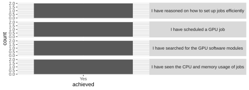

# Reflection Bianca Intermediate 2026-11-23

- Course: Bianca Intermediate
- Date: 2026-11-23
- Author: Richel
- [Lesson plan](../../lesson_plans/20261123/20261123_richel.md)
- [Evaluation](../../evaluations/20261123/README.md)
- [Reflection](../../reflections/20261123/20261123_richel.md)

## After teaching

I am quite unhappy how things went.
It felt too sloppy and too low-energy.
I started at 5:00 this morning to
prepare and I never had the time to properly
take a look at my material.
I feel the material was good enough, but
I was not connected to it. I felt the
goals were not clear enough to me.

- [ ] Go through the material and polish it

I did not demo. I think I should.

- [ ] Add 'Demo' to course material

GPU took 45 minutes, not 30.

- [ ] Update schedule to reflect this

With both GPU and efficient jobs
I did do a prior.

I talked to much. Instead, do a demo with the
exercises.

- [ ] Search for ways to talk less.
  Replace talk by demo or exercise time

I did have a good time with the learners.
I was able to hear their background.

## Evaluation results

I have achieved 100% of what I wanted:

[Any feedback](../../evaluations/20261123/any_feedback.txt):

- Good material!
- The course was at a good pace, I had time to solve all the exercise
  without stress. All the teachers are very helpful and knowledgeable.
  Thank you for organizing it!

I am very happy that people could work without stress. Well done us!

